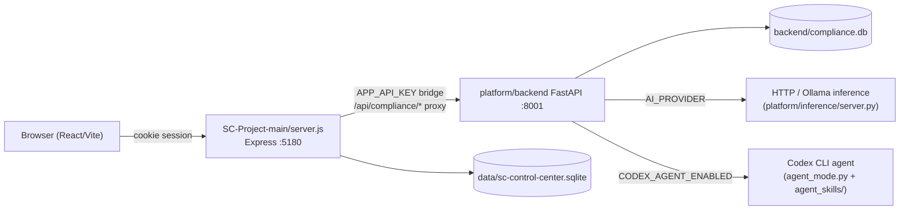
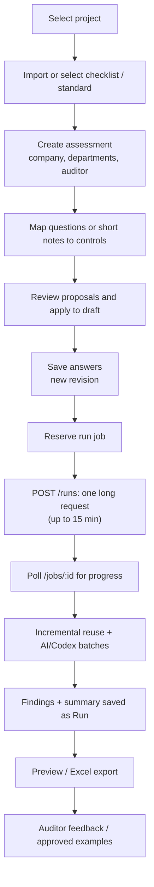

# SC AI: Workflow Review and Improvement Plan

_Reviewed 2026-11-23. Based on a read of the code, logs, git state and a partial test run._

## 1. How the system works today



### Compliance assessment flow (user view)



### Developer and ops flow
- `Start-SC.ps1` and `Stop-SC.ps1` start uvicorn and node as hidden processes. Logs go to `.runtime/`.
- There is no CI, no lint step and no single test command. Verification is three manual commands from the README.
- Git: 3 commits (`first`, `fix-skill.md`, `second_juning`), all on one branch. Uncommitted changes in `agent_mode.py` add parallel Codex batches.

---

## 2. What I found

### Healthy
- The assessment pipeline is well thought out: revision checks (`expected_version`), incremental reuse by input fingerprint, checkpoints, cancellation, and an audit log.
- There are 55 backend test files, and the frontend bridge has its own tests.
- Secrets and databases are covered by `.gitignore` (`.env`, `*.db`, `data/`, `.runtime/`).

### Problems (ordered by impact)

| # | Area | Finding | Evidence |
|---|------|---------|----------|
| 1 | **Env / tests** | `platform/.venv` points to the Microsoft Store Python (`WindowsApps\...Python.3.12`). It cannot start from other shells or sandboxes, so the backend tests could not run. | `platform/.venv/pyvenv.cfg` |
| 2 | **Tests** | The last recorded runs left about 34 failing backend tests. These are in `test_native_sc.py` (Excel export), `test_codex_agent_mode.py`, `test_codex_provider.py`, `test_api.py` (end-to-end) and others. | `.pytest_cache/v/cache/lastfailed`, `platform/.pytest_cache/...` |
| 3 | **Tests** | Frontend: 9 of 10 pass. `compliance-mapping.test.mjs` failed (the 8.8 s timeout looks like a spawned server not starting; it may be environment-related). | `node --test SC-Project-main/tests/*.mjs` |
| 4 | **Run architecture** | A run is a **single blocking HTTP request**. The proxy waits up to 15 minutes (`timeoutMs:900000`), and the `cloudflared`/Vercel demo tunnel will cut it earlier. Progress lives in **in-memory** job dicts (`assessment_jobs.py`), so a backend restart loses running jobs and their progress. | `server.js:1785`, `main.py:1049`, `assessment_jobs.py` |
| 5 | **Consent** | The UI always sends `authorize_external: true`, so the backend's "authorize external data" gate never actually asks the user. | `ComplianceAssessment.jsx:95,118` |
| 6 | **Access scoping** | `/api/compliance/projects/:projectId/jobs/:jobId` (and `/cancel`) checks project access but not that the job belongs to that project's assessment. A user with access to any project could read or cancel another job by its ID. | `server.js:1786-1787` |
| 7 | **Code size** | `server.js` is 178 KB, `main.py` is 78 KB, `ai.py` is 56 KB, `main.jsx` is 69 KB and `inference/server.py` is 73 KB. Style is dense (many statements per line, `;`-chained). This makes review, merges and testing hard. | file sizes |
| 8 | **Two repos in one** | `SC-Project-main/` has its own README, `.gitignore`, `.env` and `.vercel`. Its README still says "port 5173" and "reachable only from this Mac", but the root README says 5180 on Windows. | READMEs |
| 9 | **Runtime clutter** | Several DB copies (`.runtime/import-backups`, `short-note-backups`, `vercel-demo/compliance.db`, 18 MB `backend/compliance.db`), plus `credentials.json` and tunnel PIDs under `.runtime/`. The demo tunnel is failing (`Unauthorized: Tunnel not found`), repeating every few seconds. | `.runtime/vercel-demo/tunnel-error.log` |
| 10 | **Dependencies** | `package.json` says `node >=20` but the code needs `node:sqlite` (22.5+). `platform/requirements.txt` is duplicated in `backend/requirements.txt` and includes `pytest` and `psycopg` in runtime deps. | `package.json`, `requirements*.txt` |
| 11 | **Start script** | It waits a fixed 2 s and then only checks "process exited". It never health-checks `/api/health` or confirms that node bound to port 5180. | `Start-SC.ps1:24-25` |
| 12 | **Git hygiene** | Commit messages don't say what changed. Feature work (parallel Codex batches) is uncommitted on the main line. | `git log`, `git status` |

---

## 3. Recommended improvements

### Phase 0: Unblock (about 1 day)
1. **Rebuild the venv** from a regular python.org or `py` launcher install:
   `py -3.12 -m venv platform/.venv --clear` and then `pip install -r platform/requirements.lock.txt`.
2. **Add one test entry point**, for example `scripts/Test-SC.ps1`:
   ```powershell
   .\platform\.venv\Scripts\python.exe -m pytest platform/backend/tests -q
   node --test SC-Project-main/tests/*.test.mjs
   npm.cmd --prefix SC-Project-main run build
   ```
3. **Fix the red tests** before adding features. Start with `test_native_sc.py` (Excel export is the customer deliverable) and `test_api.py::test_end_to_end_*`.
4. **Commit or branch** the uncommitted parallel-batch work in `agent_mode.py` (for example `feature/codex-parallel-batches`).

### Phase 1: Workflow correctness and safety (1–2 weeks)
5. **Make runs asynchronous.** `POST /runs` should start a background worker and return `202 {job_id}` right away. The UI then polls only `/jobs/:id`. This removes the 15-minute request and the tunnel timeouts.
6. **Persist job state** in the DB: a `run_jobs` table with status, phase, completed/failed IDs, heartbeat and `assessment_id`. On startup, mark orphaned `running` jobs as `interrupted`, so the user can resume them from `RunCheckpoint`, which already exists.
7. **Scope job endpoints.** Store `assessment_id` on the job, and in `server.js` reject a `jobId` that doesn't belong to `req.linkedAssessmentId`.
8. **Real consent step.** Before the first external (Codex/HTTP) run on each revision, show a dialog that names the provider and the data being sent. Only then set `authorize_external`, and log who approved it.
9. **Health-checked startup.** In `Start-SC.ps1`, poll `http://127.0.0.1:8001/api/health` and `:5180` for up to about 30 s, and print the last log lines if a check fails.

### Phase 2: Maintainability (ongoing)
10. **Split large files by feature:**
    - `main.py` → `routers/assessments.py`, `runs.py`, `evidence.py`, `skills.py`, `feedback.py`
    - `server.js` → `routes/auth.js`, `users.js`, `planning.js`, `documents.js`, `compliance-bridge.js`
    - `main.jsx` → page components plus a shared `api.js` (the `api()` helper is duplicated in several components)
11. **Formatter and linter:** `ruff format` and `ruff check` for Python, and `prettier` and `eslint` for JS. Running them once will expand the dense one-line code and make diffs readable.
12. **CI** (GitHub Actions or a pre-commit hook) that runs the Phase 0 test script on every push.
13. **Fix the docs:** merge the two READMEs, fix port and OS mentions, set `"engines": {"node": ">=22.5"}`, and move `pytest` into `requirements-dev.txt`.

### Phase 3: Workflow UX
14. **Stepper UI** for the assessment page: *Setup → Answers → Map/Review → Run → Review findings → Export*. Show the state of each step (revision saved? unsaved draft? stale run?).
15. **Stale-result banner:** when `current_version` is newer than the last run's `revision`, say so and offer "Reassess changed controls only" (this uses the existing incremental reuse).
16. **Failure triage view:** list `failed_control_ids` and `warnings` from `assessment_plan`, with "retry only failed" as one click.
17. **Feedback loop dashboard:** surface `feedback-summary` and approved examples, so auditors can see how corrections improve grading over time.

### Housekeeping
- Add a `scripts/Clean-Runtime.ps1` that removes old `.runtime/*-backups` (keep the last N) and stale tunnel PID and log files.
- Stop or reconfigure the Vercel-demo tunnel, which is failing (`Tunnel not found`). Move `.runtime/vercel-demo/credentials.json` to a secret store.
- Use descriptive commit messages (`feat(codex): parallel batch workers`) and short-lived feature branches.

---

## 4. Suggested priority

| Priority | Item | Effort | Impact |
|---|---|---|---|
| P0 | Rebuild venv, single test script, fix red tests | S | High |
| P0 | Scope job endpoints to the assessment (#7) | S | High (security) |
| P1 | Async runs + persisted jobs (#5, #6) | M | High (reliability) |
| P1 | Real consent dialog (#8) | S | High (compliance) |
| P1 | Health-checked start script (#9) | S | Medium |
| P2 | Split files + formatter + CI (#10–12) | M–L | High (long term) |
| P2 | Stepper, stale banner, failure triage (#14–16) | M | Medium–High |
| P3 | Docs/deps cleanup, runtime cleanup | S | Low–Medium |
